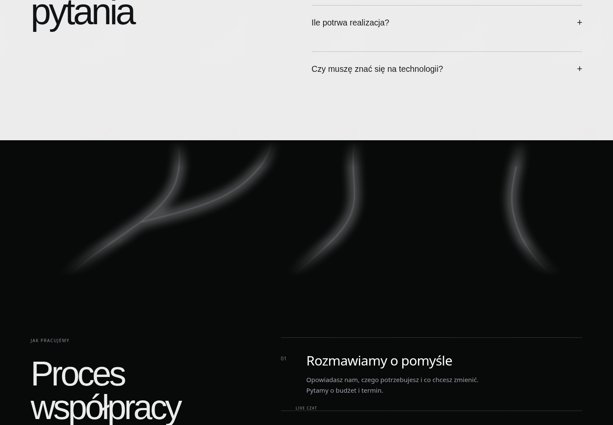

# COSGRAL service cards

The first approved editorial concept with the original smaller category labels.
Illustrations are optimized WebP artwork extracted from the approved generated design; category labels, links, discipline tags and arrows remain live HTML/SVG. All six illustrations total approximately 190 KB. The existing entrance, pointer parallax and service expansion interactions are retained. Artwork motion pauses outside the viewport and with reduced-motion preferences. Narrow phones use one column; wider screens use two or three.

## Preview


[Mobile preview](services-mobile.png)

## Transition after the white FAQ section

Soft monochrome branches draw and travel upward with scroll before the cooperation process. The effect uses local SVG and the existing scroll animation engine, with a static reduced-motion fallback. Service title fonts share the same family, size and weight; SEO has a small optical tracking adjustment.



[Mobile transition](transition-mobile.png)

## Run and verify

From the repository root:

```sh
python3 -m http.server 8765 --bind 127.0.0.1 --directory designkopia/cosgral-agency
```

In a second terminal:

```sh
node scripts/check-service-cards.mjs
node scripts/check-service-interactions.mjs
node scripts/check-service-transition.mjs
```

These browser checks use the repository's existing Puppeteer package and `/usr/bin/chromium`. The interaction check uses the documented `forceMotion` option for the full-motion desktop case, then clears it for reduced motion. GPU effects are unavailable during these UI checks; the existing WebGL hero is outside this change.
