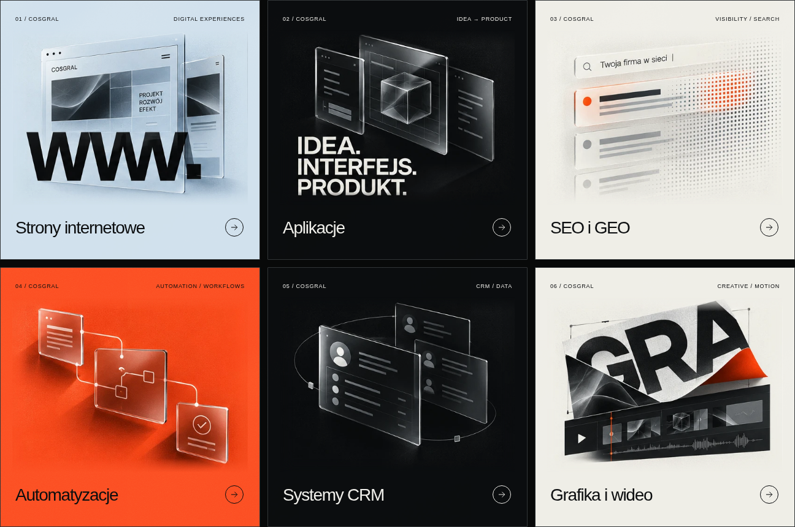
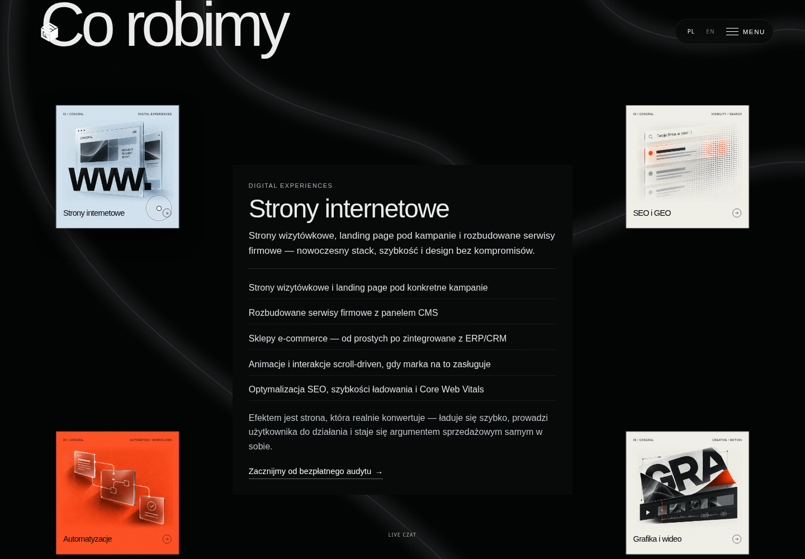

# COSGRAL service cards

The first approved editorial concept with the original smaller category labels.
Illustrations are optimized WebP artwork extracted from the approved generated design; category labels, links, discipline tags and arrows remain live HTML/SVG. All six illustrations total approximately 190 KB. The existing entrance, pointer parallax and service expansion interactions are retained. Artwork motion pauses outside the viewport and with reduced-motion preferences. Narrow phones use one column; wider screens use two or three.

## Preview



[Mobile preview](services-mobile.png)

## Chrome effects and media

Full effects are enabled by default, regardless of pointer detection. `?reduceMotion` explicitly disables motion and autoplay, while `?respectMotion` follows the OS preference. Chrome without WebGL receives a lightweight animated SVG atmosphere and the original cube poster instead of a blank background or a fixed logo over content. A fallback is not the full 3D renderer.

Cards lift and enlarge on hover/focus. Open descriptions use the brand font, larger neutral high-contrast text and separated list rows without red dashes.



Portfolio videos have no native controls. They load shortly before reaching the viewport, play muted/inline and pause offscreen. Original MP4 files are untouched. Same-resolution, same-frame-rate VP9 WebM alternatives are used only if MP4 support is absent or fails. These are re-encoded compatibility alternatives, not lossless copies. Blocked autoplay retries on a user gesture without exposing a player bar.

The decorative transition between sections remains removed.

## Performance

The local server now sends gzip-compressed text with ETag revalidation and supports byte-range media requests. A measured sample of Three.js, GSAP and the two main stylesheets transferred 225,249 bytes instead of 882,741 bytes (74.5% less), with identical decompressed contents. A video range request returned exactly 1,024 bytes with HTTP 206. These are transfer measurements, not a claim of a 74.5% faster page or a physical-device frame-rate benchmark.

Redundant per-frame navigation updates and permanently promoted card layers were removed. Netlify caching headers were added for versioned vendor assets and portfolio media. Visual effects and original MP4 quality remain available.

## Run and verify

From the repository root:

```sh
python3 scripts/serve-agency.py --port 8765
```

In a second terminal:

```sh
node scripts/check-service-cards.mjs
node scripts/check-service-interactions.mjs
node scripts/check-chrome-effects.mjs
node scripts/check-media-fallbacks.mjs
python3 scripts/check-preview-server.py
```

These browser checks use the repository's existing Puppeteer package and `/usr/bin/chromium`. They verify labels/layout, hover and pointer motion, expansion/Escape, all four videos actually decoding and advancing without controls, codec/network/autoplay fallbacks, and explicit reduced-motion behavior. They isolate the UI from GPU rendering. A separate Chromium run with SwiftShader also confirmed rendered frames from both the hero cube and ambient WebGL background; this is not a physical GPU performance measurement.
